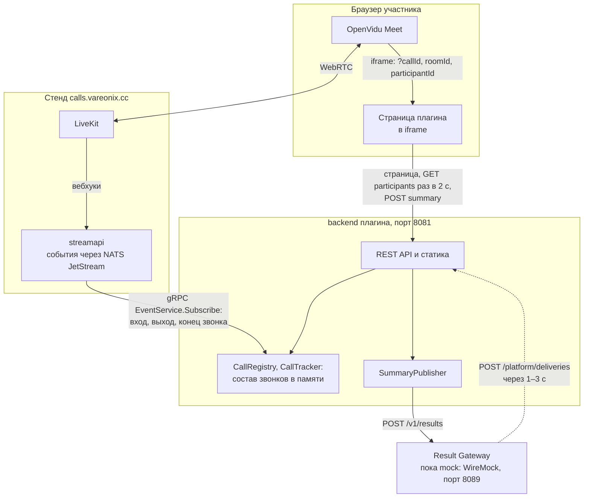
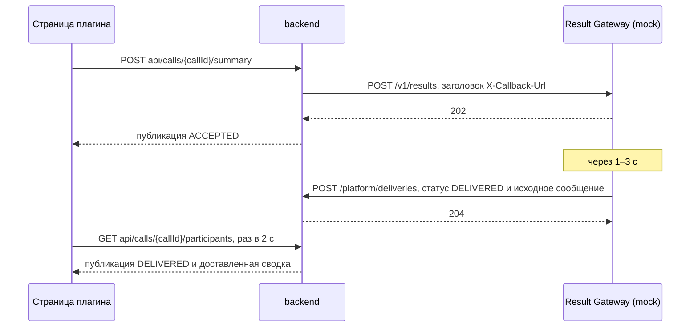

# plugin-attendance

Плагин посещаемости для звонков. Версия 0.1 показывает, кто сейчас в звонке и кто из него вышел, по событиям [streamapi](https://github.com/dwspurpleteam/streamapi), и публикует сводку посещаемости через Result Gateway платформы.

## Как это устроено



- **frontend** — самостоятельный npm-проект: React, Vite, TypeScript. Его сборку Gradle кладёт в jar backend, поэтому страницу и API отдаёт один процесс.
- **backend** — самостоятельный Gradle-проект на Java 25 и Spring Boot 4.1 со своим wrapper и двумя модулями: `core` — код плагина, `assembly` — main class, настройки и исполняемый jar. Первый запрос по `callId` подписывает плагин на `participant.joined`, `participant.left` и `call.ended`, состав звонка хранится в памяти. Если 10 минут от страницы плагина нет запросов, то есть в звонке её никто не держит открытой, отслеживание останавливается.
- **Источник событий** — streamapi (по умолчанию) или `fake`: генератор внутри backend для разработки без стенда. С ним вместо Meet плагин открывают на странице `dev-host.html`, а участников добавляют кнопками.
- **Сводка** — кнопка «Опубликовать сводку» отправляет в Result Gateway число участников в звонке и вышедших. Настоящего Result Gateway ещё нет, его заменяет WireMock с маппингами из `wiremock/`: он принимает сводку и через 1–3 с сообщает плагину о доставке. Подробнее — в разделе [Сводка через Result Gateway](#сводка-через-result-gateway).

## Требования

- Java 25 (LTS). Плагин собирается, тестируется и запускается через `bootRun` на JDK 25, какой бы JDK ни запускал Gradle: для самого Gradle подойдёт любой JDK 17+ в `JAVA_HOME` или `PATH`. Установленный JDK 25 Gradle находит сам, а если не найдёт, скачает в `~/.gradle/jdks`. Готовый jar запускается на Java 25 и новее.
- Node.js ставить не нужно: при первой сборке Gradle скачает Node 24 в `backend/.gradle/`.
- Для работы со streamapi на стенде нужна сеть, в которой gRPC (HTTP/2) доходит до `calls.vareonix.cc:443`. Если прокси режет HTTP/2, используйте демо-режим.

## Быстрый старт с демо-данными

Все команды Gradle запускаются из `plugins/plugin-attendance/backend`:

```shell
cd plugins/plugin-attendance/backend

# Windows (PowerShell)
.\gradlew.bat bootRun --args='--attendance.source=fake'

# Linux, macOS
./gradlew bootRun --args='--attendance.source=fake'
```

Первый запуск занимает несколько минут: Gradle скачивает зависимости и Node. Для кнопки «Опубликовать сводку» во втором терминале запустите mock Result Gateway, без него публикация завершится статусом «не отправлена»:

```shell
.\gradlew.bat resultGatewayMock   # Windows; Linux, macOS: ./gradlew resultGatewayMock
```

Потом откройте одну из страниц:

- <http://localhost:8081/dev-host.html> — плагин в iframe с `sandbox="allow-scripts"`, как в OpenVidu Meet, и кнопки «Вошёл», «Вышел», «Завершить звонок» и «Обрыв связи на 5 с».
- <http://localhost:8081/?callId=demo> — страница плагина напрямую.

Без кнопок событие можно отправить запросом:

```shell
# bash
curl -X POST localhost:8081/dev/calls/demo/events -H 'Content-Type: application/json' \
  -d '{"type":"participant.joined","participantId":"anna-0123456789abcde"}'

# PowerShell
Invoke-RestMethod -Method Post http://localhost:8081/dev/calls/demo/events -ContentType 'application/json' `
  -Body '{"type":"participant.joined","participantId":"anna-0123456789abcde"}'
```

## С настоящим звонком на стенде

Звонок и подписка должны быть в одном окружении: без [профиля](#профили) `stage` backend подписывается на streamapi prod и звонков stage не видит.

### Через dev-host.html

Подходит для prod и stage, деплой не нужен.

1. Запустите backend без параметров: `.\gradlew.bat bootRun` (Windows) или `./gradlew bootRun`. Он подпишется на streamapi prod по адресу `calls.vareonix.cc:443`.
2. Зайдите в звонок на <https://calls.vareonix.cc/meet/> и узнайте `callId` — это SID комнаты LiveKit вида `RM_…`, а не имя комнаты.
   - Откройте DevTools (F12) → Network, отфильтруйте WS и выберите соединение `rtc?…` → вкладка Messages.
   - Одно из первых входящих бинарных сообщений (JoinResponse) содержит SID. Переключите просмотр сообщения на UTF-8 и найдите `RM_`.
   - Либо скопируйте сообщение как Base64 и выполните в консоли `atob('<base64>').match(/RM_\w+/)[0]`.
3. Откройте <http://localhost:8081/dev-host.html?callId=RM_…>.
4. Заходите в звонок и выходите из него со второй вкладки или с телефона: список меняется через одну–три секунды.

### В окне Meet на stage

Meet на stage собран из форка с плагинами, и плагин посещаемости в нём уже подключён (см. [Встраивание в Meet](#встраивание-в-meet)).

1. Запустите backend с профилем `stage`.
2. Сделайте его доступным по https по адресу плагина из `MEET_PLUGINS`, например туннелем на `localhost:8081`. Чтобы Meet открывал ваш backend, замените адрес в deployer на свой.
3. Включите в браузере окружение stage, как описано в README [deployer](https://github.com/dwspurpleteam/deployer), и зайдите в звонок.
4. Нажмите «Посещаемость» на панели Plugins: плагин откроется в окне звонка, `callId` Meet подставит сам.

Другие окружения:

- **stage**: включите [профиль](#профили) `stage`: `--args='--spring.profiles.active=stage'`. Он добавляет к подписке cookie окружения stage, без неё запросы уходят в prod.
- **локальный streamapi**: `--attendance.streamapi.target=localhost:19090 --attendance.streamapi.plaintext=true`.

Несколько параметров передаются через пробел: `--args='--server.port=8090 --attendance.source=fake'`.

## Сводка через Result Gateway

По [спецификации платформы](https://github.com/dwspurpleteam/specs) backend плагина не пишет в звонок сам: результаты и команды он отправляет в Result Gateway. Тот проверяет сообщение, адресатов и лимиты и доставляет результат участникам. Плагин посещаемости публикует так сводку.



- Сводку backend собирает по текущему составу звонка. Адресаты — все, кто сейчас в звонке, ревизия растёт с каждой публикацией.
- Запрос UI ждёт только ответа Result Gateway о приёме, о доставке тот сообщает позже, по адресу из `X-Callback-Url`.
- Доставки могут прийти в любом порядке: более старая ревизия, чем уже доставленная, отбрасывается.
- Последняя доставленная сводка и статус последней публикации приходят в ответе `participants`. Сводку видят все, у кого открыт плагин в этом звонке.

Сообщение в Result Gateway — формат `call.result` из спецификации:

```json
{
  "type": "call.result",
  "messageId": "0b9c2a52-…",
  "callId": "RM_xxx",
  "recipients": ["anna-0123456789abcde", "boris-zzzzzzzzzzzzzzz"],
  "key": "attendance.summary",
  "revision": 3,
  "payload": {
    "composedAt": "2026-10-22T11:20:00Z",
    "trackingSince": "2026-10-22T11:05:00Z",
    "present": 2,
    "left": 1,
    "publishedBy": "anna-0123456789abcde"
  }
}
```

Отчёт о доставке — исходное сообщение целиком и статус: `{"status": "DELIVERED", "reason": null, "message": {…}}`, при отказе `REJECTED` и причина.

Статусы публикации:

| Статус | Что произошло |
| --- | --- |
| `SENDING` | Сообщение отправляется в Result Gateway |
| `ACCEPTED` | Result Gateway принял сообщение (2xx), ждём отчёта о доставке |
| `DELIVERED` | Пришёл отчёт о доставке |
| `REJECTED` | Result Gateway отклонил сообщение (4xx или отчёт с отказом), причина в `reason` |
| `FAILED` | Result Gateway недоступен, не ответил вовремя или ответил 5xx |

### Mock Result Gateway

Задача `resultGatewayMock` запускает WireMock на порту 8089 с маппингами из `wiremock/mappings/`:

- `results-accept.json` — отвечает `202` и через 1–3 с отправляет отчёт `DELIVERED` по адресу из `X-Callback-Url`;
- `results-reject-empty-recipients.json` — отвечает `422` на сообщение с пустым `recipients`, например если публиковать после завершения звонка.

Полученные сообщения видны в журнале WireMock: <http://localhost:8089/__admin/requests>, а с `--verbose` — и в консоли. Чтобы проверить статус `FAILED`, остановите mock (Ctrl+C). Тот же WireMock можно запустить и без Gradle: `java -jar wiremock-standalone-3.13.2.jar --port 8089 --root-dir plugin-attendance/wiremock`.

Если WireMock работает не на той машине, что backend, например в Docker, задайте адрес для отчёта явно: `--attendance.result-gateway.callback-url=http://host.docker.internal:8081/platform/deliveries`.

## Сборка и запуск jar

Из `backend/`:

```shell
.\gradlew.bat build    # тесты, сборка frontend и assembly/build/libs/plugin-attendance.jar
java -jar assembly/build/libs/plugin-attendance.jar --attendance.source=fake
```

## Разработка фронтенда

Для hot reload запустите backend в демо-режиме, а во втором терминале — Vite:

```shell
cd plugins/plugin-attendance/backend; .\gradlew.bat npm_run_dev   # Node, скачанный Gradle
cd plugins/plugin-attendance/frontend; npm run dev                # или свой Node 20.19+ / 22.12+
```

Страница будет на <http://localhost:5173/?callId=demo>, запросы `api/` Vite перенаправляет на `localhost:8081`. Страница `dev-host.html` относится к backend: она работает только на порту 8081 и показывает уже собранный фронтенд.

## Настройки backend

Задаются аргументами `--имя=значение`, переменными окружения (`ATTENDANCE_SOURCE=fake`), в файлах [профилей](#профили) или в `backend/assembly/src/main/resources/application.yaml`. Приоритет убывает в том же порядке.

| Свойство | По умолчанию | Назначение |
| --- | --- | --- |
| `attendance.source` | `streamapi` | Источник событий: `streamapi` или `fake` |
| `server.port` | `8081` | HTTP-порт плагина |
| `attendance.streamapi.target` | `calls.vareonix.cc:443` | Адрес gRPC streamapi; внутри docker-сети стенда `nginx:19090` |
| `attendance.streamapi.plaintext` | `false` | Подключение без TLS |
| `attendance.streamapi.metadata.<заголовок>` | — | Дополнительные заголовки подписки, например cookie для stage |
| `attendance.tracking.idle-timeout` | `10m` | Через сколько без запросов UI отслеживание звонка останавливается |
| `attendance.tracking.max-calls` | `100` | Сколько звонков отслеживается одновременно |
| `attendance.tracking.ignored-participant-prefixes` | `streamapi-`, `EG_` | Служебные участники: скрытый получатель streamapi, запись |
| `attendance.fake.event-interval` | `6s` | Как часто генератор меняет состав; `0s` — только события из кнопок и запросов |
| `attendance.result-gateway.url` | `http://localhost:8089` | Адрес Result Gateway; по умолчанию mock из `resultGatewayMock` |
| `attendance.result-gateway.callback-url` | `/platform/deliveries` этого процесса на localhost | Куда Result Gateway отправляет отчёт о доставке |
| `attendance.result-gateway.connect-timeout` | `2s` | Сколько ждать соединения с Result Gateway |
| `attendance.result-gateway.read-timeout` | `5s` | Сколько ждать ответа о приёме сообщения |

Остальные настройки, например паузы переподключения к streamapi и параметры генератора `fake`, описаны комментариями в `application.yaml`.

### Профили

Настройки окружений лежат в `backend/assembly/config/application-<профиль>.yml`. Сейчас профиль один — `stage`, он задаёт cookie для подписки на streamapi stage. Без профиля backend работает с prod.

В git файл `application-stage.yml` лежит с заглушкой `<secret>`. Замените её на секрет окружения stage и не коммитьте эту правку. Пока заглушка на месте, backend с профилем `stage` не запустится и назовёт причину: иначе подписка молча ушла бы в prod.

Профиль включается аргументом `--spring.profiles.active=stage`: в `bootRun` — через `--args='--spring.profiles.active=stage'`, в IDE — полем Active profiles или тем же аргументом. Файл профиля находится, если процесс запущен из `backend` или из `backend/assembly`, так что подходят и `bootRun`, и запуск jar, и IDE с рабочей папкой по умолчанию.

Какое окружение получилось, видно в `GET /api/info`, на странице `dev-host.html` и в логе при старте (`Event source: streamapi …`). Со stage там `заголовки: cookie`, без профиля — `без доп. заголовков`. Если плагин показывает «Онлайн», но вошедшие участники не появляются, проверьте первым делом это: подписка в prod на звонок stage принимается, но событий не получает.

## API backend

| Запрос | Ответ |
| --- | --- |
| `GET /api/calls/{callId}/participants` | Состав звонка. Первый запрос запускает отслеживание |
| `POST /api/calls/{callId}/summary?participantId=…` | Публикует сводку через Result Gateway и возвращает статус публикации. `participantId` необязателен, он попадает в сводку как автор. Отказ и недоступность Result Gateway — это статусы `REJECTED` и `FAILED`, а не ошибки запроса |
| `POST /platform/deliveries` | Отчёт Result Gateway о доставке. `404`, если звонок уже не отслеживается |
| `GET /api/info` | Источник событий, адрес Result Gateway и версия |
| `GET /actuator/health` | Проверка доступности |
| `POST /dev/calls/{callId}/events` | Только в демо-режиме. Тело `{"type": "participant.joined", "participantId": "…"}`; без `participantId` войдёт случайный участник или выйдет случайный присутствующий. Типы: `participant.joined`, `participant.left`, `call.ended` |
| `POST /dev/calls/{callId}/connection-loss?seconds=5` | Только в демо-режиме: имитация обрыва связи с источником |

Пример ответа о составе звонка:

```json
{
  "callId": "RM_xxx",
  "source": "streamapi",
  "status": "TRACKING",
  "statusMessage": null,
  "trackingSince": "2026-10-22T11:05:00.123Z",
  "endedAt": null,
  "gaps": [{ "from": "2026-10-22T11:07:03Z", "to": "2026-10-22T11:07:05Z" }],
  "serverTime": "2026-10-22T11:20:00.456Z",
  "present": [{ "participantId": "anna-0123456789abcde", "joinedAt": "2026-10-22T11:06:00Z", "leftAt": null }],
  "left": [{ "participantId": "boris-zzzzzzzzzzzzzzz", "joinedAt": null, "leftAt": "2026-10-22T11:10:00Z" }],
  "summary": {
    "publication": {
      "messageId": "0b9c2a52-…",
      "revision": 3,
      "status": "DELIVERED",
      "reason": null,
      "requestedAt": "2026-10-22T11:20:00Z",
      "updatedAt": "2026-10-22T11:20:02Z"
    },
    "delivered": {
      "revision": 3,
      "deliveredAt": "2026-10-22T11:20:02Z",
      "recipients": 1,
      "summary": { "composedAt": "2026-10-22T11:20:00Z", "trackingSince": "2026-10-22T11:05:00Z", "present": 1, "left": 1, "publishedBy": "anna-0123456789abcde" }
    }
  }
}
```

`summary.publication` и `summary.delivered` равны `null`, пока сводку не публиковали и пока ни одна публикация не доставлена.

Возможные статусы:

- `CONNECTING` — подписка ещё не установилась.
- `TRACKING` — события приходят.
- `RECONNECTING` — связь потеряна, плагин переподключается.
- `ENDED` — звонок завершён.
- `FAILED` — streamapi отказал в подписке, повтор через минуту.

`joinedAt: null` означает, что участник вошёл до начала отслеживания. Ошибки приходят в формате `application/problem+json`, текст для пользователя лежит в поле `detail`.

## Встраивание в Meet

Окна плагинов есть в форке [openvidu-meet](https://github.com/dwspurpleteam/openvidu-meet), ветка `feat/iframe-to-plugin`. Список плагинов Meet берёт из переменной окружения `MEET_PLUGINS`:

```json
[{"id": "attendance", "title": "Посещаемость", "url": "https://<адрес плагина>/"}]
```

На панели Plugins в звонке у каждого плагина своя кнопка: она открывает и закрывает окно с iframe. Пока нет подписанного контекста запуска, Meet передаёт контекст в адресе:

```
<url>?callId=<room.sid>&roomId=<room.name>&participantId=<identity>
```

- Окно — iframe с `sandbox="allow-scripts"`. У такой страницы opaque origin, поэтому плагин не использует cookies и `localStorage`, а backend отдаёт и API, и статику с `Access-Control-Allow-Origin: *`.
- Адрес страницы должен заканчиваться на `/`: пути к ассетам и API относительные, так что плагин работает и под префиксом вроде `/plugins/attendance/`.
- Meet открыт по https, поэтому адрес плагина тоже должен быть https и открываться из браузеров участников: iframe по http браузер заблокирует.
- На stage `MEET_PLUGINS` задан в [deployer](https://github.com/dwspurpleteam/deployer): ветка `dev`, файл `apps/calls/meet/vars/base.yaml`. На prod работает исходный Meet, плагинов в нём нет.

## Ограничения версии 0.1

- Учитываются только входы после начала отслеживания, то есть после первого открытия плагина в звонке: streamapi не отдаёт историю и текущий состав. Кто вышел, не войдя на наших глазах, показан с пометкой «вход до начала отслеживания».
- Имён в событиях нет, только identity LiveKit. Имя гостя восстанавливается из латинского префикса identity. Кириллические имена Meet заменяет на `participant`, такие гости показаны как «Участник #метка».
- Состояние живёт в памяти одного процесса: перезапуск обнуляет списки, несколько реплик не поддерживаются.
- Авторизации нет: состав звонка видит любой, кто знает `callId`.
- Время событий LiveKit округлено до секунды. Вход и выход в одну и ту же секунду применяются в порядке прихода.
- События, пришедшие во время обрыва связи со streamapi, теряются, и плагин предупреждает, что список может быть неточным.
- Сводка отправляется в Result Gateway синхронно: если он медленный или недоступен, кнопка ждёт до `read-timeout`. Очереди и повторов пока нет.
- В сообщении нет `activationId`: контекст запуска его пока не содержит. Сообщения и отчёты о доставке не подписаны, `POST /platform/deliveries` принимает отчёт от кого угодно.
- Доставленную сводку видят все, у кого открыт плагин в звонке, а не только адресаты.

## Тесты

Из `backend/`:

```shell
.\gradlew.bat test
```

Тесты покрывают:

- в `core` — логику трекера и реестра звонков, статусы публикаций сводки, gRPC-адаптер против in-process сервера, который ведёт себя как streamapi, и HTTP-клиент Result Gateway против WireMock;
- в `assembly` — приложение целиком в демо-режиме: страницу, CORS для sandbox-iframe, API и публикацию сводки через WireMock с маппингами из `wiremock/`.

Отдельной команды для фронтенда нет: проверка типов TypeScript входит в его сборку (`npm run build`).

CI запускает `./gradlew build`, то есть тесты и сборку jar, на каждый пуш, подробнее — в [README репозитория](../README.md#ci).

## Структура

```
frontend/
  src/                    React-приложение: опрос API, список участников, публикация сводки
  public/                 статика, которая копируется в сборку как есть
  package.json, vite.config.ts, tsconfig.json
backend/
  core/                     код плагина, обычная библиотека
    src/main/java/ru/itmo/plugins/attendance/
      api/                  REST: состав звонка, публикация сводки, /platform/deliveries, /api/info, /dev/* для демо-режима
      tracking/             CallTracker — состав одного звонка, CallRegistry — какие звонки отслеживаются,
                            SummaryBoard — публикации сводки звонка
      summary/              SummaryPublisher — собирает сводку и отправляет её в Result Gateway
      gateway/              ResultGateway и HTTP-клиент, формат сообщений и отчётов о доставке
      events/               EventSource и реализации: streamapi (gRPC) и fake
      config/               CORS для sandbox-iframe, проверки настроек
    src/main/proto/streamapi/v1/events.proto   копия контракта streamapi v1.1.0 с java-опциями
  assembly/                 приложение: собирает core и frontend в исполняемый jar
    src/main/java/ru/itmo/plugins/attendance/AttendanceApplication.java   main class
    src/main/resources/application.yaml        настройки по умолчанию
    src/main/resources/static/dev-host.html    страница «плагин в окне Meet» для демо-режима
    config/application-stage.yml               профиль stage: cookie для streamapi stage
  settings.gradle.kts, build.gradle.kts, gradle/libs.versions.toml, gradlew
wiremock/
  mappings/                 mock Result Gateway: приём сводки с отчётом о доставке, отказ без адресатов
```

Версии зависимостей лежат в `backend/gradle/libs.versions.toml` (там же версия Node для сборки) и `frontend/package.json`. Версии gRPC и protobuf задаёт BOM Spring Boot.
